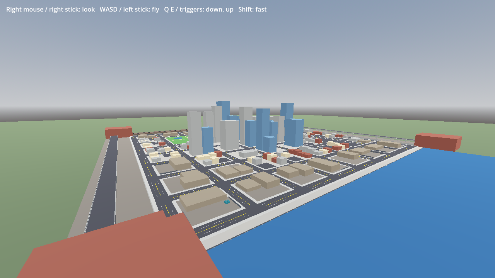

# Grid City Builder

Bake believable grid cities in Godot 4 from modular block scenes. You paint a district map as text, list the lot scenes for each district, and press **Bake**. Grid City Builder lays out the streets, sidewalks, kerb corners and junction props. It fills every block with a lot from that district's pool, varies the props and building heights from a seed, and adds navigation lanes plus lightweight box colliders.



Everything ships as placeholder boxes in a starter kit, so you can block out a city today and swap in real art (for example Synty's POLYGON City, Kenney's city kits, or your own) one scene at a time.

## Features
- **Text district map.** One character per cell: downtown, main street, industrial, parks and so on. You decide what each letter means.
- **Streets on every cell edge.** Avenues and local streets, T and L junctions, and kerb corners. Junctions get a traffic light (avenue) or a stop sign (local street).
- **Superblocks.** Multi-cell lots such as a 2×2 park or a 2×1 car park. The streets inside them are removed, and the network stays connected around them.
- **Barrier cells.** Use them for city edges (rail embankment, freeway, waterfront) or any block with no streets between neighbours.
- **Prop slots.** Mark a spot in a lot or street scene and let the seed decide the chance, jitter, rotation, variant, building height or a repeated row. The same seed always gives the same city, and editing one cell doesn't reshuffle the rest.
- **Navigation lanes.** `Path3D` lanes along every street and through every junction. The lane graph is strongly connected. Lanes follow right- or left-hand traffic, and you can attach your own lane script (for traffic or AI addons).
- **Lightweight collision.** Box colliders only, one static body per block, built from each prop's bounds. Meshes can be tagged into physics groups (e.g. `Grass`).
- **Named markers.** Spawn points, shop entrances and quest locations come out under `Markers/` in the baked city.
- **Three ways to build:** in the editor (Inspector button), headless (CLI for build scripts and CI), or at runtime (a fresh city each run).

## Quick start
1. Copy `addons/grid_city/` into your project. There is no plugin to enable.
2. Open `addons/grid_city/demo/demo.tscn` and press ▶ to fly around, or select `GridCityGenerator` and press **Bake** in the Inspector to see the city in the editor.
3. For your own city: add a **GridCityGenerator** node, create a new **GridCityLayout** in its `layout` slot (or duplicate `demo/demo_layout.tres`), set `output_path` (e.g. `res://city.tscn`) and press **Bake**.

## How a layout works
```
CNNNNNNNNC     C corner   N rail embankment   W/E freeway   S waterfront   (barriers)
WIIIMMMIIE     I industrial   M main street   D downtown
WMPPMMLLME     P park (2×2 superblock)   L car park (2×1 superblock)
WMPPDDDMME     Z a cell with an override (plaza, police station…)
...
CSSSSSSSSC
```
- **Grid.** Cell `(column, row)` covers `cell_size` metres; row 0 is north (−Z). Lattice lines run between cells.
- **Streets.** A street runs between two neighbouring cells unless both are barrier cells or both belong to the same superblock.
- **Street edges.** Each cell side with a street carries half of it: `half_street` of asphalt plus a `sidewalk`. With the defaults (100 m cells, 10 m half street, 5 m sidewalk) every 1×1 lot is 70×70 m, a 2×1 superblock lot is 170×70 m, and a barrier strip is 100×85 m.
- **Avenues.** `avenue_lines` lists the lattice lines that are avenues. They use the `avenue_edge` scene, more lanes and traffic lights, and lots turn to face them.
- **Lots.** `pools` maps each letter to the lot scenes to pick from. `cell_overrides` places a specific scene in a cell, and `cell_markers` names that cell's `MarkerSlot`.

## Authoring lots and streets
- **Lot scenes:**
  - Centred on the origin, with the front (street side) facing **−Z**.
  - The root needs a `lot_size` metadata (`Vector2`: x width, z depth). The builder checks it against the space the cell leaves.
  - Lots are rotated in 90° steps, so make lots square, or long along X for superblocks.
- **Street edge scenes:**
  - The lattice line sits at z = 0 with +Z into the cell.
  - They span x ±(cell/2 − half_street − sidewalk), i.e. ±35 m by default.
  - Every `Path3D` inside an edge is a lane running along +X, laid out for right-hand traffic (the builder reverses them for left-hand).
- **`GridCityPropSlot`** (a Marker3D):
  - `variants`, `chance`, `jitter`, `yaw_options`, `repeat` / `step`.
  - `height_range` makes the slot's scale.y a building height in metres; the slot's x/z scale is the footprint.
  - Props stay scene instances in the baked city, so editing a prop scene updates the city without a rebake.
- **Metadata tags on meshes:**
  - `solid`: give a plain lot or edge mesh a box collider.
  - `no_collider`: leave a prop part out (lamp arms, tree canopies).
  - `collision_group = "Grass"`: put this mesh's box in a separate body in that physics group.
- **Markers:**
  - A Marker3D named `MarkerSlot` in a lot becomes `Markers/<name>` when its cell is listed in `cell_markers`.
  - Marker3Ds whose names start with a prefix in `export_marker_prefixes` (e.g. `Post`) become `Markers/Post0`, `Post1`, and so on.

## Using it from code
```gdscript
# Bake at runtime (e.g. a new city per run):
var layout: GridCityLayout = load("res://my_layout.tres").duplicate()
layout.city_seed = randi()
var builder := GridCityBuilder.new()
var city := builder.build(layout)
if builder.errors.is_empty():
	add_child(city)

# Street queries for AI, spawners or a minimap:
var map := GridCityMap.new(layout)
map.has_segment(Vector2i(3, 2), Vector2i(4, 2))   # street between two junctions?
map.arms(Vector2i(5, 5))                          # directions of streets leaving a junction
map.junction_position(Vector2i(5, 5))             # local position of that junction
```
Headless bake (build scripts, CI):
```bash
godot --headless --path . --script res://addons/grid_city/tools/bake.gd -- res://my_layout.tres res://city.tscn
```

## Performance notes
A baked city is a lot of nodes: the 15×15 demo city in our own game is about 40k nodes and about 900 draw calls in view at street level. It runs at 60 fps on desktop and in a WebGL build on an Apple M4, and props use visibility ranges. For low-end or web targets, keep prop counts modest. MultiMesh batching is planned.

## Limits
Flat ground, 90° streets on a regular grid, one cell size. Lot scenes must match the sizes their cells leave.

## Development
`tests/grid_city_test.gd` checks a demo bake: no errors, one lot per claim, an edge on every street side, no trimesh colliders, markers present, the lane graph strongly connected for both traffic sides, determinism, and that broken layouts report errors.
```bash
godot --headless --path . --script res://tests/grid_city_test.gd   # GRID_CITY_TEST: PASS
```
Built with AI assistance (Anthropic's Claude) and reviewed by the author.

## License
MIT. See [LICENSE](LICENSE). The starter kit is plain primitive meshes made for this addon. Third-party art packs you pair it with keep their own licences and must not be redistributed with your fork.
